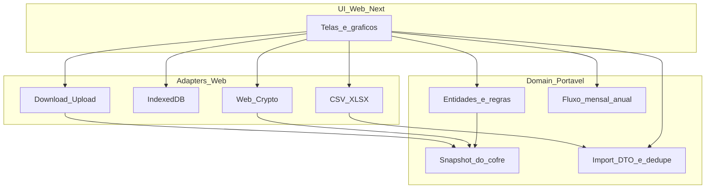

# Plano: Gestão Financeira (MVP web, preparado para app)

## Objetivo
Entregar um app **web** para uso pessoal com visão financeira **360°**, dados em **arquivo local criptografado** (`.gfin`), e arquitetura em que **regras e dados são portáveis** para iOS/Android no futuro — sem construir o app nativo agora.

## Validação: caminho 1 + migração futura
O plano anterior já acertava no cofre portátil e no escopo funcional. O que faltava era deixar **explícito** o desenho dual:

| Camada | Web (agora) | App futuro |
| --- | --- | --- |
| Domínio (entidades, cálculos, snapshot) | TypeScript puro | Reaproveitado |
| Cofre `.gfin` | Mesmo formato versionado | Mesmo arquivo / mesmo PIN |
| Crypto / storage / arquivo | Adapters Web Crypto + IndexedDB + download/upload | Adapters nativos (Keychain/Keystore, FS) |
| UI | Next.js + shadcn + Recharts | UI nativa ou Capacitor/RN — refeita ou envolvida |

**Conclusão**: seguimos com o MVP web; funcionalidades de negócio são pensadas como domínio + adapters, não acopladas ao browser.

## Decisões fechadas
- **Agora**: só web (Next.js + TypeScript + Tailwind + shadcn/ui)
- **Depois**: migração a app reaproveitando domínio + `.gfin` (via Capacitor/RN ou app nativo com a mesma lógica)
- **Escopo funcional**: rendas, aplicações, gastos recorrentes/pontuais, dívidas, metas, dashboard, cofre, **fluxo de caixa mensal/anual**, **importação de extrato CSV/XLSX**, **instituição/banco**
- **Fora desta versão**: app iOS/Android, sync na nuvem, alertas avançados, simulações, Open Banking, multi-usuário
- **Idioma da UI**: português (Brasil)
- **Persistência**:
  - Formato de cofre `.gfin` **versionado** (`version` no envelope) — contrato estável entre web e app
  - AES-GCM; chave via PIN (PBKDF2)
  - Exportar / importar `.gfin` para transição entre dispositivos
  - Cache IndexedDB (adapter web) para uso diário
  - Botão explícito “Baixar cofre” (limitação da web; no app futuro o adapter pode gravar direto no FS)
- **Gráficos**: Recharts **só na UI web** (não no domínio)
- **Importação de extrato**: 100% client-side (`papaparse` + `xlsx`); domínio recebe só DTOs normalizados

## Preparação para funcionar nos dois cenários

### Separação obrigatória no código
- `src/domain/` — tipos, validações, normalização de recorrência (→ mensal), patrimônio líquido, progresso de metas, **fluxo mensal/anual**, **import draft + dedupe**, serialização do snapshot do cofre. **Zero** React, DOM, `window`, IndexedDB ou Next.js
- `src/adapters/` — `crypto` (Web Crypto), `storage` (IndexedDB), `file` (download/upload Blob), **`bank-import`** (CSV/XLSX)
- `src/app/` (ou `src/components/`) — telas Next.js, formulários shadcn, gráficos

### Regras de portabilidade
- Toda funcionalidade de negócio passa pelo domínio (criar gasto, calcular sobra do mês, etc.)
- UI só orquestra; não calcula patrimônio “na mão” na página
- I/O de arquivo e crypto só via interfaces de adapter — no app futuro troca-se a implementação, não as telas de regra
- Datas em ISO; valores monetários em número decimal consistente (centavos ou number documentado no domínio)
- Sem APIs só-de-browser no domínio (ex.: não usar `localStorage` direto nas entidades)

### O que muda só na casca (web vs app)
- Como o usuário escolhe/salva o arquivo (download vs pasta do app)
- Onde fica o cache desbloqueado (IndexedDB vs storage seguro)
- Componentes visuais (web vs nativo)

## O que o MVP inclui (funcional)

### 1. Desbloqueio, segurança e cofre
- Criar PIN / desbloquear
- Baixar e importar `.gfin` (com confirmação ao substituir)
- Dados cifrados em repouso

### 2–8. Rendas, aplicações, gastos recorrentes, gastos pontuais, dívidas, metas, categorias
- CRUD completo; recorrência diária/semanal/mensal/anual; seeds pt-BR
- Rendas pontuais (`oneTimeIncomes`) para créditos de extrato (não confundir com renda mensal)

### 9. Dashboard
- Patrimônio líquido, fluxo do mês, gráficos, metas, atalho do cofre
- Cálculos vindos do domínio; charts só na UI

### 10. Fluxo de caixa (`/fluxo`)
- **Mensal**: mês selecionável — entradas (rendas recorrentes + pontuais) vs saídas (recorrentes normalizadas + pontuais), saldo; gráfico dos últimos 12 meses
- **Anual**: totais do ano + série mês a mês (tabela + gráfico)
- Funções em `src/domain/cashflow.ts`

### 12. Instituição / banco
- Campo opcional `institutionId` (+ `institutionOther` para Outro) em rendas, aplicações, gastos recorrentes/pontuais e rendas pontuais
- Seeds portáveis em `src/domain/institutions.ts` (Inter, Mercado Pago, Nubank, PicPay, BB, Caixa, Swile, Itaú, Bradesco, …)
- Snapshot schema **2** (parse aceita 1 e migra; envelope `.gfin` permanece v1)
- Formulários com select; badge nas listas; filtro no dashboard; coluna Banco no import CSV

### 11. Importar extrato (`/importar`)
- Upload `.csv` / `.xlsx` no browser
- Detecção flexível: delimitador `;`/`,`, decimal `,`/`.`, data `DD/MM/YYYY` ou ISO
- Auto-mapeamento de colunas (Data, Descrição/Histórico, Valor, Débito/Crédito) + override manual
- Preview com tipo (gasto/renda), categoria e inclusão; dedupe por data+valor+descrição
- Confirma → `oneTimeExpenses` / `oneTimeIncomes` no snapshot do cofre

## Arquitetura

## Telas / navegação
- `/` Dashboard · `/fluxo` · `/rendas` · `/aplicacoes` · `/gastos` · `/dividas` · `/metas` · `/categorias` · `/importar` · `/cofre`
- Instituição/banco nos lançamentos (seeds + Outro)
- PIN no boot · layout mobile-first (já usável no celular via browser)

## Ordem de implementação
1. Scaffold Next.js + layout mobile-first
2. `domain/` (tipos, cálculos, envelope `.gfin` versionado)
3. Adapters web: crypto, IndexedDB, export/import
4. Tela do cofre + PIN
5. Categorias + CRUDs
6. Dashboard (domínio → números; Recharts → visual)
7. Fluxo mensal/anual + importação CSV/XLSX
8. README (uso + importação + domínio para app futuro)

## Critério de pronto
- Fluxo 360° completo na web, com PIN e `.gfin`
- Fluxo de caixa mensal/anual e importação de extrato
- Domínio testável sem browser (funções puras)
- Envelope `.gfin` com `version` documentado — base para o mesmo arquivo abrir no app futuro
